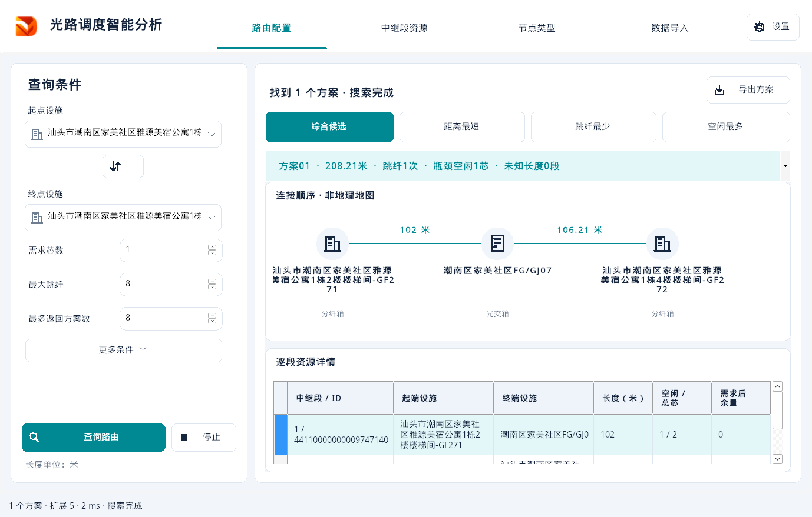
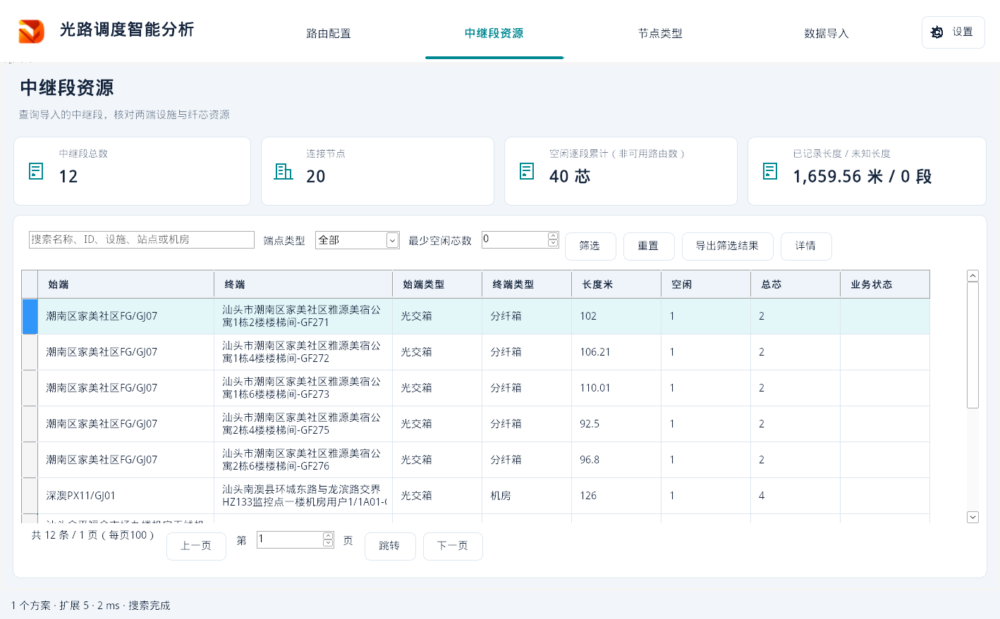
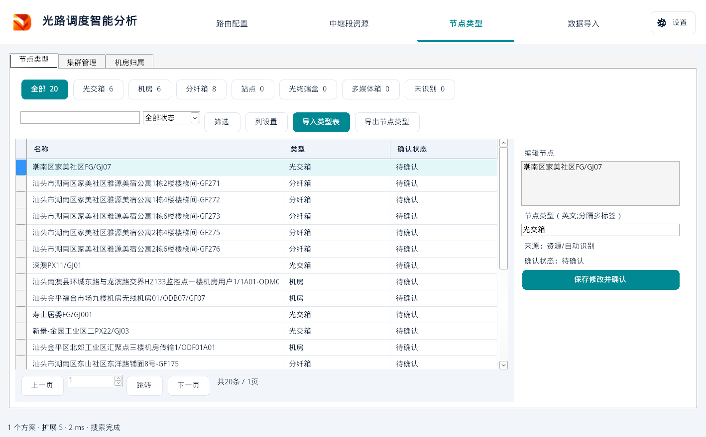
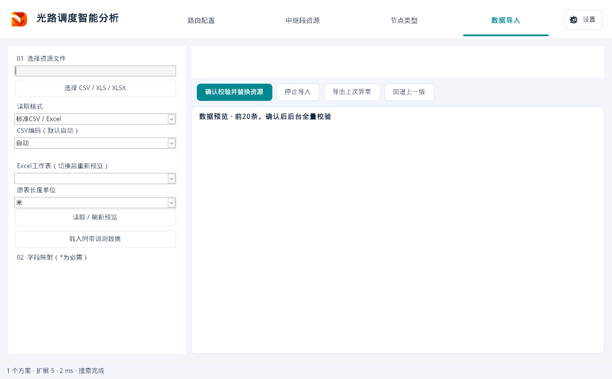
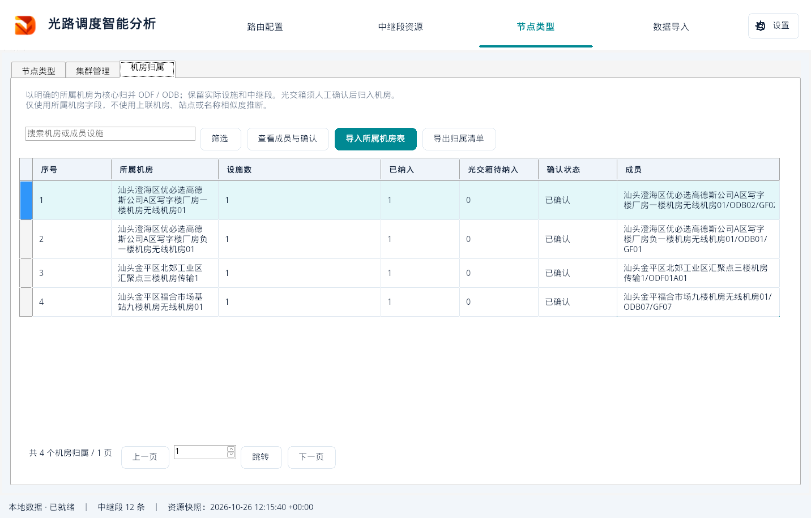

# R1.3.1 实际运行截图

对应本聊天最后确认的顶部四页导航、左侧查询、右侧方案、资源统计及列表要求。截图来自实际编译程序在 Wine 兼容环境运行，使用文泉驿中文字体及附带的 12 段 / 20 节点调测样例；机房页叠加真实表格派生的匹配归属。它们是运行结果，不是新的生成式设计图，也不等同客户 Windows 实机截图。窗口缩放、字体和系统原生控件外观可能有差异。

## 路由配置

## 中继段资源

## 节点类型

## 数据导入

## 机房归属

所属机房名称以表格为准。每个成员的实际设施和中继段均保留，光交箱在成员清单内确认纳入；同机房设备间不增加虚构的中继段和容量。
